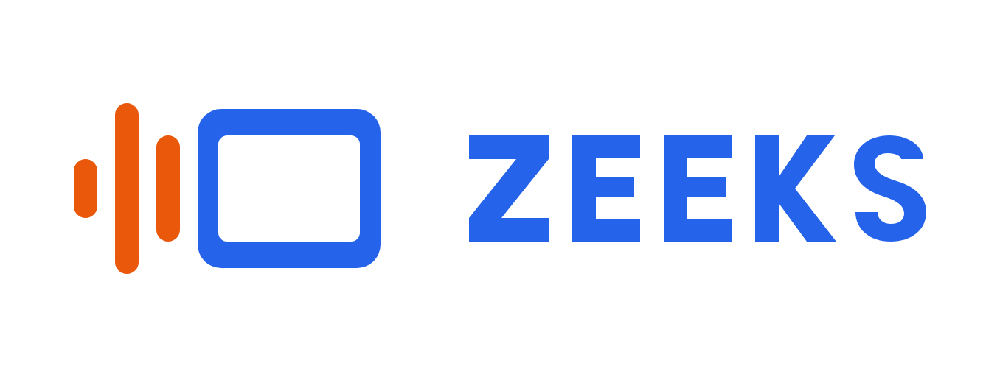

# ZEEKS · Audio vers Vidéo

<p align="center">
  
</p>

<p align="center">
  <strong>Convertisseur Studio Audio vers Vidéo MP4 · 100 % Local · Sans Cloud ni FFMPEG</strong><br>
  <em>Application Windows native haute performance écrite en Rust · Interface VU-Mètre Studio Rack</em>
</p>

---

## ⚡ Présentation de ZEEKS

**ZEEKS** convertit instantanément un fichier audio (MP3, WAV, FLAC, M4A...) et un visuel de fond (image fixe, GIF animé, WebP ou clip vidéo) en une **vidéo MP4 (H.264 + AAC 192 kb/s)** prête pour YouTube, TikTok, Instagram Reels ou les réseaux sociaux.

- **0 % Cloud, 100 % Local** : aucune donnée n'est envoyée sur un serveur distant, tout est encodé directement sur votre machine.
- **Moteur Windows Media Foundation natif** : accélération matérielle, zéro dépendance externe, pas besoin d'installer ffmpeg.
- **Thème Console Studio Rack Audio** :
  - Châssis sombre métallique (`#0B0F19`, `#121622`, `#2A3548`).
  - Identité visuelle ZEEKS en **Bleu Roi** (`#2563EB`) et **Orange Ambré** (`#EA580C`).
  - **VU-Mètre Stéréo Réactif** : double canal G & D avec échelle en dB (-24, -18, -12, -6, -3, 0 dB, PEAK), balistique analogique dynamique et veilleuse repos en pause.
  - **Animation Réactive d'Encodage** : spectrogramme oscillogramme pulsant et vibrant en rythme avec la progression du rendu.

---

## 🎛️ Fonctionnalités

| Composant | Détails |
|---|---|
| **Audio supporté** | MP3, M4A, AAC, WAV, FLAC, WMA, OGG/Opus, AIFF, AMR (tout format décodé par Windows) |
| **Visuels supportés** | JPG, PNG, APNG, GIF animé, WebP (fixe ou animé), BMP, TIFF — ou clip vidéo **MP4 / MOV / AVI / WMV / MKV / WebM** |
| **Formats de sortie** | **16:9** (1920×1080 - YouTube / Desktop), **9:16** (1080×1920 - Reels / TikTok / Shorts), **1:1** (1080×1080 - Feed) |
| **Cadrages visuels** | `Remplir` (cover avec recadrage auto), `Contenir` (image intégrale sur fond studio), `Fond flou` (version floutée dynamique en arrière-plan) |
| **Qualités de débit** | Léger (4 Mb/s) · Standard (8 Mb/s) · Haute fidélité (16 Mb/s à 1080p) |
| **Pré-écoute & VU-mètre** | Lecteur winmm à faible latence, barre de recherche, raccourci Espace, VU-mètre analogique avec aiguilles de crête |
| **Export vidéo** | Profil H.264 High, audio AAC stéréo 48 kHz à 192 kb/s, conteneur MP4 optimisé pour le streaming |

---

## 🚀 Utilisation

### Mode Graphique (GUI)
1. **Étape 01 - Audio** : Glisse ton fichier audio ou clique sur « Choisir un fichier ». Lance la lecture pour observer le **VU-mètre stéréo** réagir en temps réel.
2. **Étape 02 - Visuel** : Ajoute une image ou une vidéo par glisser-déposer, sélection de fichier, `Ctrl+V` (presse-papiers ou URL) ou téléchargement direct.
3. **Étape 03 - Réglages** : Sélectionne le format (16:9, 9:16, 1:1), le cadrage et la qualité.
4. **Étape 04 - Rendu** : Clique sur **GÉNÉRER LE MP4 (STUDIO RENDER)**. Observe l'animation dynamique d'oscillogramme et de crêtes pendant l'encodage !

### Mode Ligne de Commande (CLI / Scripts / Batch)

```bat
zeeks.exe --convert --audio "musique.mp3" --visual "cover.jpg" --out "video.mp4"
          [--format 16:9|9:16|1:1] [--fit fill|contain|blur] [--quality light|standard|high]
          [--log "rapport.txt"]
```

Code de retour : `0` si l'export a réussi, `1` en cas d'erreur.

---

## 🛠️ Compilation & Déploiement

### Prérequis
- [Rust](https://rustup.rs) (toolchain GNU `stable-x86_64-pc-windows-gnu` ou MSVC).
- MSYS2 binutils (pour la compilation sous toolchain GNU).

### Construction rapide avec `build.bat`
Lance simplement :
```bat
build.bat
```
Le script compile le binaire optimisé en mode release et le copie automatiquement dans `dist\zeeks.exe`.

### Compilation manuelle
```powershell
cargo build --release
# Le binaire se trouve dans target\release\zeeks.exe
```

---

## 🏛️ Architecture du Projet

```text
zeeks/
├── assets/
│   ├── icon.png                 # Icône native de l'application
│   └── logo/kit/                # Kit complet de logos officiels ZEEKS
│       ├── zeeks_lockup_horizontal.png
│       ├── zeeks_symbol.png
│       └── BRAND_GUIDELINES.md
├── src/
│   ├── main.rs                  # Interface egui Studio Rack, VU-mètre & boucle principale
│   ├── mf.rs                    # Media Foundation Windows : décodage PCM, encodage H.264/AAC, analyse RMS/Peak
│   ├── player.rs                # Lecteur audio waveOut à tampons glissants & extraction dynamique des niveaux
│   ├── visual.rs                # Décodage & composition des images / vidéos en NV12
│   ├── job.rs                   # Pipeline multithread de rendu en tâche de fond
│   └── net.rs                   # Téléchargement d'URL via WinHTTP
├── build.bat                    # Script de compilation release Windows
└── Cargo.toml                   # Configuration et dépendances Rust
```

---

## 🔒 Confidentialité & Licence

ZEEKS est conçu pour une confidentialité totale : aucun envoi réseau, aucune télémétrie, traitement 100 % local sur votre machine.
Licence MIT ou Apache 2.0.
